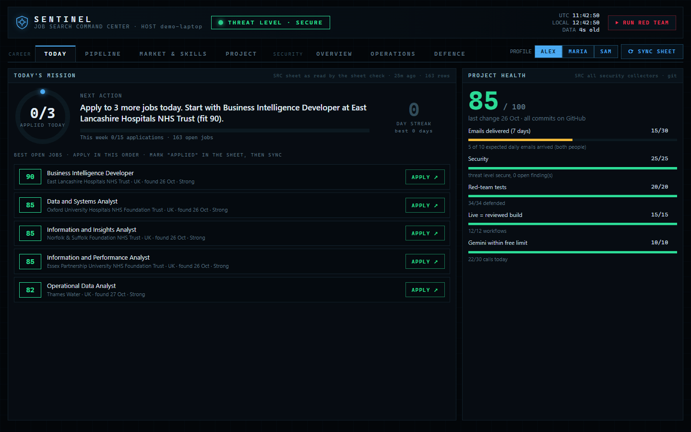
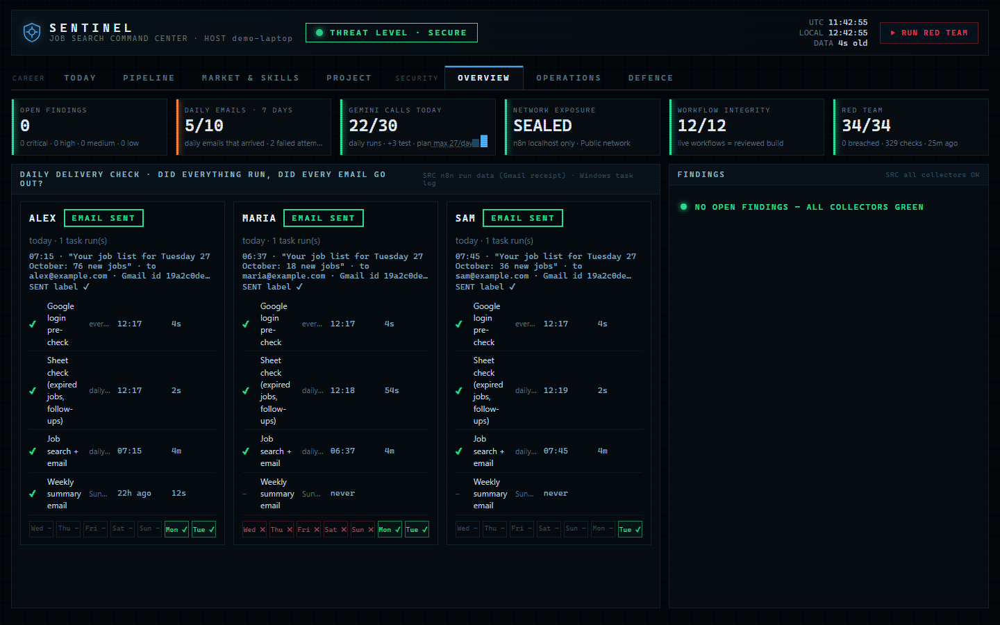
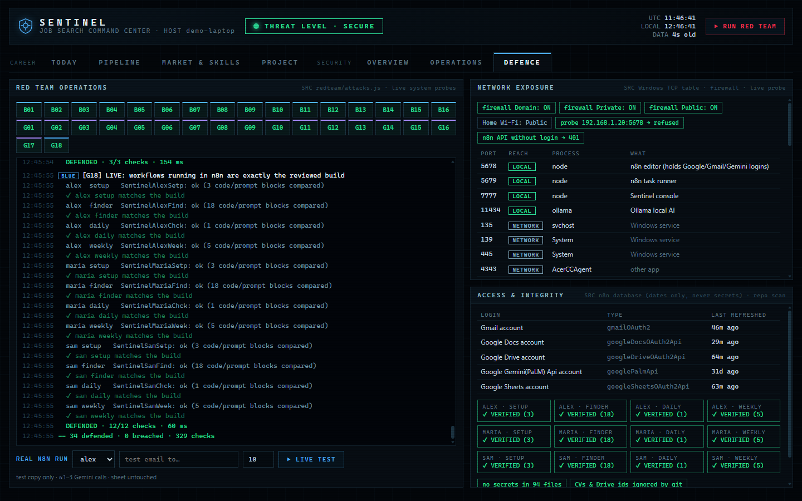
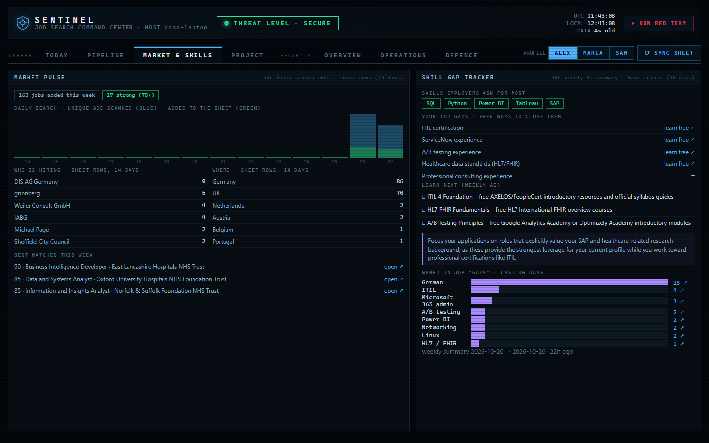
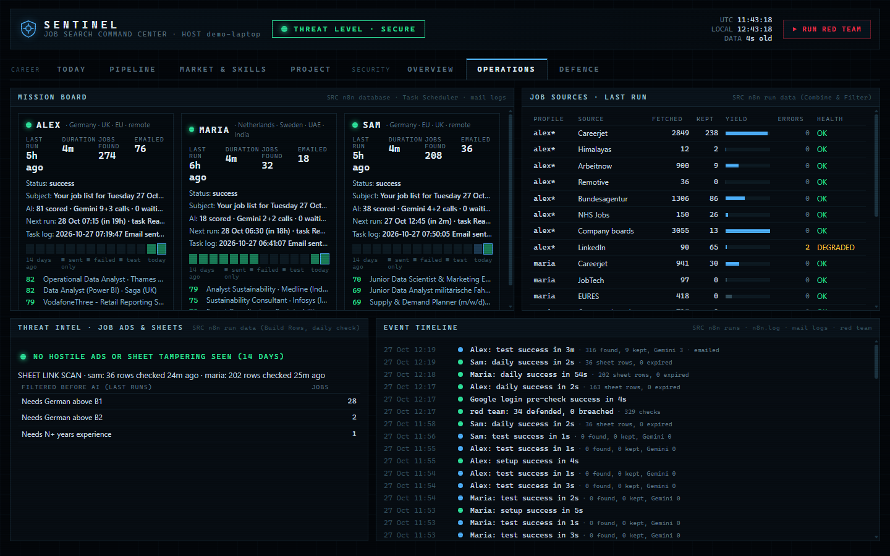

# Sentinel

**Self-hosted job-search automation with a built-in security console.**

Every morning Sentinel searches the job sources chosen for each person, removes duplicates and jobs that do not fit (wrong country, too senior,
language they do not speak, too old), asks an AI model to score every remaining job against that person's CV, adds the new jobs to their
own Google Sheet and emails them a ranked list. A local web console shows the job hunt (what to apply to today, pipeline, skill gaps) and the
health and security of the whole setup, backed by a red-team suite of 34 automated tests.

It runs on one Windows laptop with free tools: [n8n](https://n8n.io) (self-hosted workflow engine), the Google Gemini API free tier,
Google Sheets, Docs, Drive and Gmail, and Windows Task Scheduler. There is no server to rent and nothing to pay for.

**Status:** in daily use since October 2026 by 3 people with different searches (data/BI in Germany and the UK; sustainability/ESG in the
Netherlands, Sweden, the UAE and India; data and retail analytics in Germany and the EU). Two more people are joining.



> All screenshots come from the console's demo mode (`node redteam/server.js --demo`): the people are fictional, the job ads are real public ads.

## Contents

1. [What it does](#what-it-does)
2. [Screenshots](#screenshots)
3. [How it works](#how-it-works)
4. [Security](#security)
5. [Costs and limits](#costs-and-limits)
6. [Setup guide (step by step)](#setup-guide-step-by-step)
7. [Daily use](#daily-use)
8. [Adding another person](#adding-another-person)
9. [Troubleshooting](#troubleshooting)
10. [Known limitations](#known-limitations)
11. [Responsible use and legal notes](#responsible-use-and-legal-notes)
12. [Repository layout](#repository-layout)
13. [License](#license)

## What it does

**In one sentence:** instead of a person opening ten job sites every morning, the laptop does it for them, throws away the jobs that
clearly do not fit, lets an AI read the rest next to their CV, and sends them a short ranked list.

**Words used below:**
- *Profile*: one settings file per person (`finder/profiles/<name>.js`). It says where they want to work, what to search for, and what to filter out.
- *Workflow*: a chain of steps in n8n, like a recipe. Each person gets their own set of workflows, built from their profile.
- *Job sheet*: the person's Google Sheet. One row per job. Tab **Jobs** holds the jobs worth a look; tab **Seen** (hidden) remembers
  every job already handled, so it is never sent again.
- *Fit score*: a number from 0 to 100 for "how well does this CV match this ad".

### Job finder: what happens each morning, in order

1. **Search.** The finder asks each job source switched on in the profile for new ads, using the profile's search words and countries.
   Sources: Careerjet, LinkedIn (its public job search, without logging in), the national job agencies of Germany (Bundesagentur für Arbeit),
   the UK health service (NHS Jobs), Sweden (JobTech) and the EU (EURES), the job boards Arbeitnow, Himalayas and Remotive, and the
   public career pages of chosen companies on Greenhouse, Ashby, SmartRecruiters, Recruitee, Workable and Teamtailor.
   Adzuna can be added with a free key. A source that fails is recorded and skipped; the others carry on.
2. **Merge duplicates.** The same job often appears on several sites. Jobs with the same company (first word of its name), the same title
   and the same country become one job. The version with the longest description is kept; the other links go into the *More Links* column.
3. **Filter (simple rules, no AI).** A job is dropped when:
   - its title contains a word from the profile's "exclude" list (for example *senior*, *director*), or none of the wanted title words;
   - it is not in one of the profile's countries (remote jobs are kept if the profile allows remote work);
   - it is older than the profile's limit (for example 4 days);
   - the ad clearly requires a language level the person does not have (for example German above B1 for someone at A2);
   - the ad is not in English, in a country where the person cannot read the local language;
   - it asks for 5 to 15 years of experience (larger numbers are usually the company's age), or it is director level;
   - it is an internship only open to enrolled students (the example people have already graduated).
4. **Skip what was already handled.** A job is skipped if its link (or one of its other links), or the same company + role, is already in
   the Jobs or Seen tab.
5. **Limit the AI work.** At most `maxJobsToScore` jobs a day go to the AI (100 for the `alex` example). If there are more, the profile's main
   countries are filled first, taking turns between sources, newest first. The rest are not lost: they come up again in the next run.
6. **Prepare the AI request.** Ten jobs are sent per AI call, together with the CV. Before that, email addresses and phone numbers are
   removed from the CV, and any text in an ad that tries to give the AI instructions is cut out (see [Security](#security)).
7. **Score with Gemini (Flash-Lite model).** For every job the AI writes what the ad asks for and the matching evidence from the CV, then gives
   four part scores. The program, not the AI, adds them up:

   | Part | Points | Question |
   |---|---|---|
   | Skills | 0–40 | Are the required skills on the CV, with real use? |
   | Experience | 0–25 | Is the person's experience at the level asked? |
   | Domain | 0–15 | Is the job's field close to the person's studies and work? |
   | Must-haves | 0–20 | Degree, language, location and work permit met? |

8. **Apply the safety caps.** The AI may name a *hard blocker*: a required language, a place the person cannot work from, a job limited to a group
   they do not belong to (for example "EU citizens only"), a clearly senior role, or a different profession. A blocker only counts if the AI
   quotes words that really appear in the ad; the program checks that. Then:
   - with a blocker, the score is at most **45**;
   - if nothing on the CV matches the ad, at most **60**;
   - if the ad probably needs the local language but does not say so clearly, at most **69**.
9. **Double-check the best jobs.** Jobs scoring 65 or more are scored again by a stronger model (Gemini Flash), with a longer part of the ad.
   Its score replaces the first one. These are the jobs people actually apply to, so accuracy matters most here.
10. **Verdict.** Strong = 75 or more, Good = 55 or more, Possible = 40 or more, Weak = below 40.
11. **Write the sheet.** Jobs with a score of 40 or more (`minFitScoreToLog`) are added to the Jobs tab with: role, company, country, link,
    score and verdict, why it fits, gaps, 2–3 suggested CV changes (only re-using things already on the CV, never invented ones), visa and
    language notes, salary (also converted to EUR per year with that day's exchange rates). For the UK and the Netherlands, the employer is
    looked up in the official visa-sponsor lists (UK Home Office, Dutch IND). Lower scores and dropped jobs go to the Seen tab.
    If the AI fails for a job, that job is *not* marked as seen, so it is scored in the next run.
12. **Send the email.** All new jobs, best first (at most 25), an "Apply today" top 5, and reminders for follow-ups that are due. An email is
    sent even on a day with no new jobs, so the person knows the system ran.

### Daily sheet check (no AI, runs before the finder)

- When the person sets a job's Status to **Applied**, the **Applied On** date is filled in.
- 7 days after applying, **Follow-up** shows *Due – send a short follow-up*.
- Jobs still marked **To apply** 2 or more days after they were found have their link opened (at most 50 per day). If the ad is gone,
  the Status becomes **Expired**. If the site cannot be reached, it is simply tried again the next day.

### Weekly summary (Sundays)

One AI call reads the week's jobs and writes: the skills employers asked for most, the person's most common gaps, and three next steps
with a free way to learn each (it is told never to recommend paid courses). A row with the week's numbers is added to the sheet.

### Sentinel console (local web page)

| Tab | Shows |
|---|---|
| Today | The best open jobs in the order to apply, today's goal, streak |
| Pipeline | How many jobs are To apply / Applied / Interview / Offer / Rejected, follow-ups due, applications per week |
| Market & skills | Jobs found per day, who is hiring, where, the skills asked for most and the person's gaps |
| Project | A health score for the whole setup, recent changes (git), ideas list |
| Overview | Did every person's email go out today (checked against the Gmail "SENT" label), open findings, AI calls used |
| Operations | Each person's last run, every job source's results and errors, filtered ads, an event timeline |
| Defence | The red-team suite with a live log, open network ports, firewall, login expiry, workflow integrity |

### Red-team suite (34 tests, about 330 checks)

Runs the real workflow code against hostile input and checks the live setup. Two groups:

- **Attacks (grey):** prompt injection in job ads (also hidden in other languages and look-alike letters), fake prompt sections, garbage AI
  answers, invented blockers, HTML/JavaScript in ads and in the shared sheet (XSS in the email), spreadsheet formulas, links in the sheet that
  point at the laptop or the home network (SSRF), slow or hostile job sites, regex freezes (ReDoS), giant ads, command-line injection,
  forged requests against the console, and live probes: can another device on the Wi-Fi reach n8n, does the n8n API answer without a login.
- **Defences (blue):** no secrets in any file or in the whole git history, CVs and Drive ids kept out of git, AI calls capped even when
  3,000 jobs arrive at once, an AI outage loses no job, duplicate floods become one row, people's builds do not leak into each other,
  n8n's known vulnerabilities and version age, Google login expiry, weekly backup, console security headers, file permissions on n8n's data
  folder, and that the workflows running in n8n are exactly the reviewed build.

Run it with `node redteam/run.js` or the **Run red team** button in the console.

## Screenshots

| Overview: did every email go out | Defence: red team and exposure |
|---|---|
|  |  |
| **Market & skills** | **Operations** |
|  |  |

## How it works

```
Windows Task Scheduler, one task per person (wakes the laptop, retries every hour for 6 hours)
  └─ tools/daily.ps1 -Person <id>
       1. Google login pre-check (read only)   expired login → popup, nothing is written
       2. daily sheet check (no AI)            Applied On, follow-ups, expired links
       3. job finder                           fetch → merge and filter → Gemini score → recheck → sheet + email
       4. Sundays: weekly summary
     At most one email per person per day.

finder/profiles/<id>.js ──finder/build-workflows.js──▶ finder/workflows/<id>/*.json ──tools/host.js──▶ n8n

redteam/server.js (http://127.0.0.1:7777) reads the n8n database, n8n's log, Task Scheduler, the mail logs and git ──▶ redteam/dashboard.html
```

- **One profile file per person** holds everything person-specific: countries, search words, title filters, sources, AI instructions,
  email text, schedule. The console and the tests pick up every file in `finder/profiles/` automatically.
- **The code of every n8n Code node is a normal file** in `finder/src/` (shared helpers in `finder/src/lib/`). The build inlines it into
  the workflows, so it can be read, tested and compared. The red team checks that what runs in n8n matches the build exactly.
- **The workflows run from the command line** (`n8n execute`), so the n8n window does not need to be open for the daily emails.

## Security

- **Job ads are treated as hostile input.** Text aimed at the AI is removed before scoring and the job is flagged; the AI's answer is
  validated (a broken or manipulated answer cannot change other jobs); email HTML is escaped; sheet writes are stored as plain text, never as formulas.
- **Links from the sheet** (which a person may edit) are only opened if they are public web addresses: no IP addresses in any spelling,
  no internal names, redirects re-checked.
- **Only reachable from the laptop itself.** n8n and the console listen on 127.0.0.1. The console also refuses requests with a foreign
  Host header (DNS rebinding) and cross-site posts, and sends Content-Security-Policy and no-framing headers.
- **No secrets in the repository.** Logins are stored encrypted by n8n on the laptop; the console only reads login names and dates.
  CVs, Drive ids and logs are git-ignored, and the suite scans the whole git history for secrets.
- **Privacy:** email addresses and phone numbers are removed from the CV before it is sent to Gemini. On the Gemini free tier, Google may
  use what is sent to improve its products: do not use it for CVs that must stay confidential.

## Costs and limits

- **Cost: none.** n8n self-hosted, the Gemini API free tier and a normal Google account are free; no credit card is needed.
  Do not click "Set up billing" in Google AI Studio.
- **Gemini free-tier limits** (as shown in Google AI Studio for this project in October 2026; Google changes them, check
  [aistudio.google.com/rate-limit](https://aistudio.google.com/rate-limit)): Flash-Lite models 500 requests per day, Flash models 20 per day.
  Scoring uses Flash-Lite (one call per 10 jobs); the double-check uses Flash. With the example settings, one person uses at most 8–13 calls
  a day (`alex.js`: 10 scoring + 3 double-check; `maria.js`: 6 + 2) plus one on Sundays.
- **Google logins expire every 7 days** while the Google Cloud app is in "Testing" mode (see [Troubleshooting](#troubleshooting)). The console
  warns 2 days before.
- **The laptop must be on (or asleep, not shut down) and plugged in** at the scheduled time. The task wakes it from sleep, catches up if it
  was off, and retries every hour for 6 hours.

## Setup guide (step by step)

This takes about 1–2 hours the first time. You do not need to write code; you will copy and paste a few commands and edit one text file.

**You need:** a Windows 10 or 11 laptop, a Google account (Gmail), and your CV.

> **How to open PowerShell:** press the Windows key, type `PowerShell`, press Enter. A blue or black window opens; this is where you
> paste commands (right-click pastes). Press Enter after each command.

### Step 1: Install Node.js

1. Go to [nodejs.org](https://nodejs.org) and download the **LTS** version for Windows (version 24 or newer).
2. Run the installer and keep all default options.
3. Check it worked: open PowerShell and run `node --version`. You should see `v24...` or higher.

### Step 2: Install n8n

1. In PowerShell run:
   ```
   npm install -g n8n
   ```
   This takes about 10–15 minutes. Warnings in yellow are normal.
2. Check: `n8n --version` shows a version number.

### Step 3: Download Sentinel

1. On this GitHub page click the green **Code** button → **Download ZIP**.
2. Right-click the ZIP → **Extract All** → choose a simple place, for example `C:\Users\<you>\Sentinel`.
   (The rest of this guide calls this folder *the Sentinel folder*.)

### Step 4: Start n8n and create your n8n account

1. In the Sentinel folder, double-click **`start-n8n.bat`**. A window opens; the first start takes 1–3 minutes.
   Keep this window open while you set things up.
2. When the window says *Editor is now accessible*, open **http://localhost:5678** in your browser.
3. Create the owner account (name, email, password). This account only exists on your laptop.

### Step 5: Get a free Gemini API key

1. Go to [aistudio.google.com](https://aistudio.google.com) and sign in with your Google account.
2. Click **Get API key** → **Create API key**. Copy the key (it starts with `AIza`). Keep it private.

### Step 6: Let n8n use your Google account (Sheets, Docs, Drive, Gmail)

Google requires a small "app" in Google Cloud so that n8n may act for you. It is free.

1. Go to [console.cloud.google.com](https://console.cloud.google.com) and sign in. Accept the terms if asked.
2. At the top, click the project picker → **New project** → name it `Sentinel` → **Create**, then select it.
3. Turn on the four APIs: menu **APIs & Services → Library**, search for and **Enable** each of these:
   **Google Sheets API**, **Google Docs API**, **Google Drive API**, **Gmail API**.
4. Set up the consent screen: menu **APIs & Services → OAuth consent screen** (newer consoles call it **Google Auth Platform**).
   Click **Get started**, enter an app name (`Sentinel`) and your email, choose **External** as the audience, finish.
   Then under **Audience → Test users** click **Add users** and add your own Gmail address.
5. Create the login client: **Clients** (or **Credentials → Create credentials → OAuth client ID**) → type **Web application** →
   under **Authorized redirect URIs** add exactly:
   ```
   http://localhost:5678/rest/oauth2-credential/callback
   ```
   Click **Create**. Copy the **Client ID** and **Client secret**.

### Step 7: Add the logins to n8n

In n8n (http://localhost:5678) open **Credentials** (left menu, or **Overview → Credentials**) → **Create credential**, five times:

| Search for | What to fill in |
|---|---|
| **Google Gemini(PaLM) Api** | The API key from step 5 |
| **Google Sheets OAuth2 API** | Client ID and Client secret from step 6, then **Sign in with Google** |
| **Google Docs OAuth2 API** | Same Client ID / secret, **Sign in with Google** |
| **Google Drive OAuth2 API** | Same Client ID / secret, **Sign in with Google** |
| **Gmail OAuth2 API** | Same Client ID / secret, **Sign in with Google** |

When Google warns *"Google hasn't verified this app"*, click **Continue** (it is your own app), tick all permissions and allow. Save each credential.

### Step 8: Create your profile

1. In the Sentinel folder, open `finder\profiles`. Copy `alex.js` and rename the copy to your name in lowercase letters only, for example `sam.js`.
2. Save your CV as plain text: open it in Word, **File → Save As → Plain Text (.txt)**, and save it as `finder\sam-cv.txt`
   (same name as your profile, ending in `-cv.txt`). It is never uploaded to GitHub.
3. Open your profile with Notepad (right-click → **Open with → Notepad**) and change these lines. Keep the quotes and commas as they are.

| Line | Change it to |
|---|---|
| `id: 'alex'` | your profile name, e.g. `id: 'sam'` |
| `cvFile: 'examples/alex-cv.txt'` | `cvFile: 'sam-cv.txt'` |
| `timezone`, `currency2` | your time zone (e.g. `Europe/London`) and a second salary currency (`GBP`, `USD`, ...) |
| `prompt.role` | the jobs you want, in one sentence, e.g. `'junior accountant roles in Ireland and the UK'` |
| `prompt.languageRule`, `domainHint` | which language levels are a problem for you; a hint about your field (or `''`) |
| `redteamMarkers` | 2–3 phrases that appear only in your profile (used by the privacy test), e.g. a phrase from `aboutMe` |
| `host.ids` | six new workflow ids, 16 letters/digits each, e.g. `SentinelSamFind1`, `SentinelSamChck1` ... (must be unique) |
| `host.names` | your name in `folder`, `sheet`, `cvDoc`, `label`, `sender`; `time` = when your email should come; `where` = a short text for the console |
| `host.stateFile` | `host-sam.json` |
| `host.brokerPort` | an internal port number (a "door" n8n uses on your own laptop). Each person needs their own, and the daily task uses that number + 1. The examples use 5695–5698 and the console 5699, so use `5691` for the first new person, `5693` for the next |
| `search.searchWords` | what you would type into a job site, e.g. `['accountant', 'accounts assistant']` |
| `search.titleWordsA` | words of which at least one must be in the job title |
| `search.excludeTitleWords` | words that drop a job, e.g. `'senior'`, `'director'` |
| `search.aboutMe` | where you live, where you want to work, work permit / visa, languages, graduation |
| `search.countries`, `primaryCountries` | where you want to work |
| `careerjet`, `bundesagentur`, `nhs`, `jobtech`, `eures`, `companyBoards` | which sources to use; set a source to `null` (or `[]` for `companyBoards`) to switch it off |
| `useLinkedIn`, `linkedInLocations` | `useLinkedIn: false` switches LinkedIn off (see [Responsible use](#responsible-use-and-legal-notes)) |
| `emailGreeting`, `emailFooter` | the first and last line of your daily email |

`finder/profiles/maria.js` is a second example (sustainability jobs, sheet shared with the person) if your search is closer to that.

### Step 9: Test run (nothing goes live)

Close nothing; n8n may keep running. In PowerShell, go to the Sentinel folder and run a test (use your own profile name and email):

```
cd C:\Users\<you>\Sentinel
node tools/host.js --profile=sam --to=you@gmail.com --test --max=10
```

The first time, this creates the folder named in `host.names.folder` (e.g. **"Sam Job Finder"**) in your Google Drive, with your job sheet and a copy of your CV.
Then it searches all sources, scores at most 10 jobs (about 2–3 AI calls) and emails you a list whose subject starts with **TEST**.
It takes 3–10 minutes. Your sheet is not changed by a test.

Not happy with the jobs? Change the search words or filters in your profile and run the test again.

### Step 10: Go live

```
node tools/host.js --profile=sam --to=you@gmail.com
```

This imports your workflows into n8n and formats your job sheet. It ends with the link to your sheet.

### Step 11: Run it every morning (Windows Task Scheduler)

1. Press the Windows key, type **Task Scheduler**, open it. Click **Create Task...** (not "Basic Task").
2. **General** tab: Name `Sam Daily Job Email`. Leave *Run only when user is logged on* selected.
3. **Triggers** tab → **New**: *Daily*, start time e.g. `07:15`. Tick **Repeat task every** `1 hour` **for a duration of** `6 hours`. OK.
4. **Actions** tab → **New**: Program `powershell.exe`, arguments (change the folder and name):
   ```
   -NoProfile -ExecutionPolicy Bypass -WindowStyle Hidden -File "C:\Users\<you>\Sentinel\tools\daily.ps1" -Person sam
   ```
5. **Conditions** tab: tick **Wake the computer to run this task**; untick **Start the task only if the computer is on AC power**.
6. **Settings** tab: tick **Run task as soon as possible after a scheduled start is missed**; *If the task is already running*: **Do not start a new instance**. OK.
7. Test it once: right-click the task → **Run**. After a few minutes `logs\sam-mail.log` in the Sentinel folder says `Email sent: ...`.
   The hourly repeats do nothing once the day's email has gone out.

### Step 12: Open the console

Double-click `tools\open-sentinel.vbs` in the Sentinel folder. It starts the console in the background and opens http://127.0.0.1:7777.
For a desktop icon: right-click `open-sentinel.vbs` → **Show more options → Send to → Desktop (create shortcut)**.

To check the setup, open the **Defence** tab and click **Run red team** (about 1–2 minutes). A fresh install shows a few expected
warnings, for example no weekly backup set up.

## Daily use

1. Leave the laptop plugged in overnight (sleep is fine; do not shut it down).
2. Read the morning email, or open the console's **Today** tab, and apply to the best jobs.
3. After applying, set the job's **Status** in your sheet to **Applied** (the console's **Sync sheet** button updates it right away).
   Applied On, the 7-day follow-up reminder, the pipeline and the streak all come from that column.
4. Set **Interview**, **Offer**, **Rejected** or **Not for me** when that happens; the sheet greys out closed jobs.
5. Glance at **Overview** now and then: every person should show **EMAIL SENT**, and Findings should be empty.

## Adding another person

Repeat steps 8–11 with a new profile file, a new CV file, new workflow ids and a different `brokerPort`.
With `shareSheet: true` in their profile, their sheet is shared with the email address given to `--to`, so they can update their own Status column.
Keep the total AI calls within the free limits ([Costs and limits](#costs-and-limits)): `maxJobsToScore ÷ jobsPerAiCall` scoring calls plus up to
`recheck.maxJobs ÷ recheck.jobsPerCall` double-check calls per person per day.

## Troubleshooting

| Problem | What to do |
|---|---|
| Popup "job email was NOT sent" or the console shows a login error | The Google logins expire every 7 days in Testing mode. In n8n → **Credentials**, open **Google Sheets**, **Google Docs**, **Gmail** and **Google Drive** one by one → **Sign in with Google** → **Save**. The email then goes out with the next hourly retry. |
| No email and no popup | Open `logs\<name>-mail.log` in the Sentinel folder. To run by hand: `powershell -ExecutionPolicy Bypass -File tools\daily.ps1 -Person <name> -Force` |
| `n8n` or `node` is "not recognized" | Close and reopen PowerShell after installing. If it persists, reinstall Node.js with default options. |
| `localhost:5678` does not open | n8n is not running: double-click `start-n8n.bat` and wait 1–3 minutes (the first start after an update takes longer). |
| Google says "Access blocked" or "redirect_uri_mismatch" | Your Gmail address is missing under **Test users** (step 6.4), or the redirect URI is not exactly the one in step 6.5. |
| Gemini "quota" or "too many requests" | The free daily limit was reached (often after many tests). Unscored jobs are retried the next day automatically. |
| Very few jobs | Check `titleWordsA` and `excludeTitleWords` in your profile; the console's **Operations** tab shows how many ads each source found and kept. |
| Console says "workflow differs from the reviewed build" | A workflow was changed in the n8n editor. Run step 10 again to restore it. |
| Console page does not load | Double-click `open-sentinel.vbs` again; details are in `logs\sentinel.log`. |

## Known limitations

- **Windows only.** The daily script, the scheduler and several console checks use Windows tools.
- **The laptop must be on or asleep** at the scheduled time; there is no cloud fallback.
- **Google logins expire weekly** unless the Google Cloud app is published (Google's verification process); until then they need a weekly
  reconnect, about 2 minutes.
- **Job sites change.** LinkedIn's public search sometimes rate-limits (the console shows it as *degraded*), and a career site can change its
  format. The red team checks that a broken source cannot crash the run, but that source's jobs are missing until it is fixed.
- **AI scores are guidance, not truth.** The model is told to use only facts written in the CV and the ad, and blockers need a quote, but scores
  can still be wrong. Read the ad before applying.
- **Free-tier privacy:** see [Security](#security).

## Responsible use and legal notes

This project is shared for **learning and personal use**: to show how a workflow engine, an AI model and a security test suite can work
together on a real problem. It does not apply to jobs, contact employers, log into anyone's account or collect data about people.
It only reads public job ads, the same ones anyone can open in a browser, and sends the result to the person's own email.

What you should know before running it:

- **Website terms.** Most sources are public APIs or feeds that the sites offer for reading their job ads by program: Careerjet's public API,
  the NHS Jobs XML feed, Sweden's JobTech API, the Bundesagentur's job-search API (with its public key), the Arbeitnow, Himalayas and Remotive
  APIs, and the public job-board APIs of Greenhouse, Ashby, SmartRecruiters, Recruitee, Workable and Teamtailor. EURES is read through the
  search service its own website uses. Each site has its own terms; check them for your use.
  **LinkedIn is different:** it reads LinkedIn's public guest job search, which is not an official API, and LinkedIn's User Agreement
  does not allow automated access. The code keeps the volume low (a pause of 2–3.5 seconds between requests, and it stops for the day
  if LinkedIn asks it to slow down), but low volume does not change the terms. If you are unsure, set `useLinkedIn: false` in your profile.
- **Careerjet** asks API users for their own partner id. The code contains the sample id from the documentation of Careerjet's own PHP client
  (`affid` in `finder/src/fetch-boards.js`), not a personal one; sign up for your own at [careerjet.com/partners](https://www.careerjet.com/partners/) and replace it.
- **Other people's data.** Only run it for people who asked for it. Their CV is personal data: it is sent to Google Gemini for scoring and
  stored in their Google Drive. Tell them that, and see the free-tier note in [Security](#security).
- **Google and Gemini terms** apply to your use of their APIs.
- **No warranty.** The software is provided as is (see the MIT [License](LICENSE)). This section is not legal advice; the rules that apply
  depend on your country and on each website's terms.

## Repository layout

| Path | Contents |
|---|---|
| `finder/profiles/` | One file per person. Two fictional examples: `alex.js` (data / IT, Germany and UK), `maria.js` (sustainability, Netherlands and Sweden) |
| `finder/examples/` | Fictional sample CVs for the examples |
| `finder/src/` | The code of every n8n Code node; `lib/` holds shared helpers (job parsing, prompt-injection filter, link guard, scoring rules) |
| `finder/prompts/` | AI instructions: job scoring, weekly insights |
| `finder/build-workflows.js` | Builds `finder/workflows/<id>/` (setup, finder, daily check, weekly summary) from a profile and the code |
| `finder/test/harness.js` | Runs the finder's code against the live job sites without n8n, Google or AI |
| `tools/host.js` | Creates a person's Drive files, imports their workflows into n8n, `--test` mode |
| `tools/daily.ps1` | What the Windows task runs each morning |
| `tools/precheck.json` | The read-only Google login check run before every job search |
| `tools/open-sentinel.vbs` | Starts and opens the console |
| `redteam/` | Console (`server.js`, `monitor.js`, `career.js`, `dashboard.html`), red-team suite (`attacks.js`, `engine.js`, `sim.js`, `run.js`), demo data (`demo/`) |
| `start-n8n.bat` | Starts n8n on 127.0.0.1 only |

## License

MIT, see [LICENSE](LICENSE). Built by Edwin Joston Cherayath.
